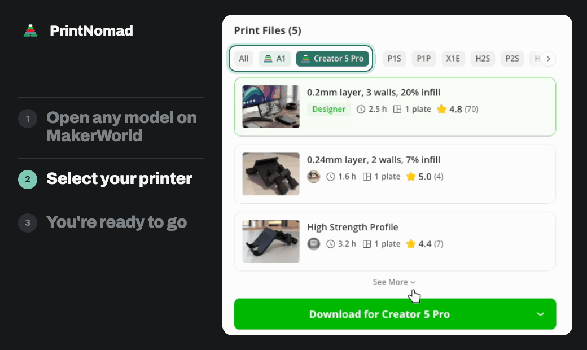
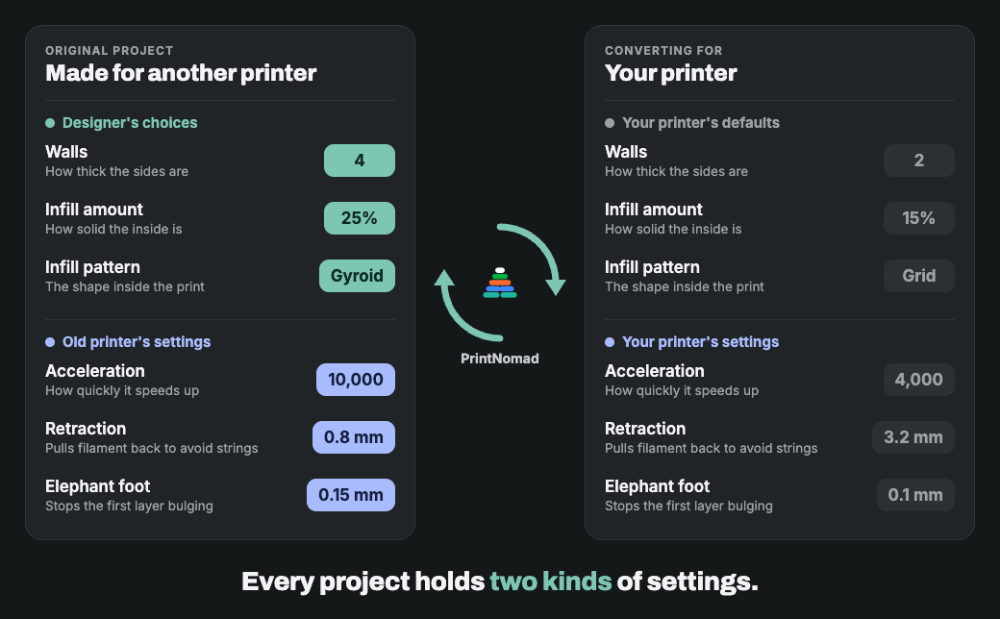
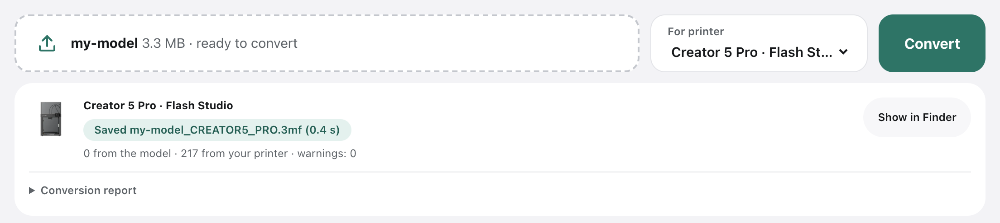
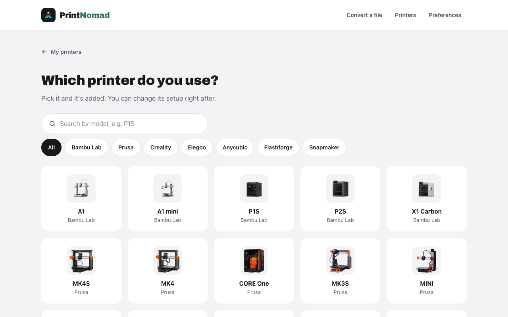
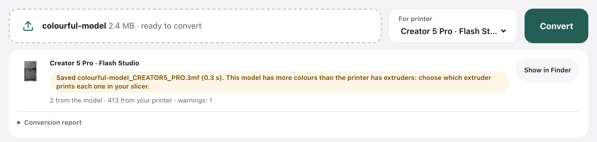
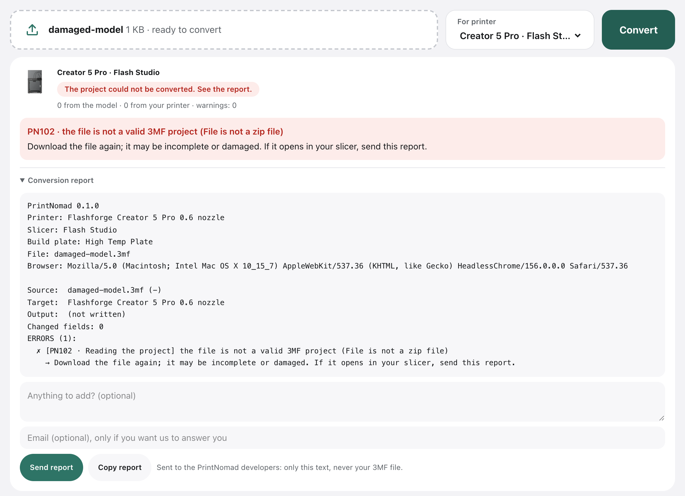

# PrintNomad

**Use 3D models from MakerWorld on your own printer, without starting over.**

PrintNomad is a free Chrome extension. Many models on MakerWorld are made for Bambu Lab printers. PrintNomad converts the 3MF project for the printer and slicer you use, and keeps the designer's settings.

## How it works

1. **Add your printer** once in the extension.
2. **Open a model on MakerWorld** and pick your printer next to the Bambu ones.
3. **Download it and open the file in your slicer.** It's ready for your printer.

## What it keeps

The settings the designer changed come with the model. The original printer's defaults, which could ruin your print, are replaced with your printer's own.

Painted colours, plates and objects are kept too, and your printer's nozzle, build plate and filament profiles are used. The original file is never modified, and the conversion report lists every change. [How a project is converted](docs/features.md) explains the details.

You can also convert a `.3mf` file you already have from the extension's page:

## Supported printers

| Brand | Printers | Slicer |
|---|---|---|
| Bambu Lab | A1, A1 mini, P1S, P2S, X1 Carbon | Bambu Studio |
| Prusa | MK4S, MK4, CORE One, MK3S, MINI, XL | OrcaSlicer |
| Creality | K1C, K2 Plus, Ender-3 V3 SE | OrcaSlicer |
| Elegoo | Centauri Carbon, Centauri Carbon 2, Neptune 4 Pro | OrcaSlicer |
| Anycubic | Kobra 3, Kobra S1 | OrcaSlicer |
| Flashforge | Creator 5 Pro, AD5X, Adventurer 5M | Flash Studio |
| Snapmaker | U1 | OrcaSlicer |

Your printer isn't listed? Ask for it from the extension's "add a printer" screen.

## Good to know

- **This is a beta.** Check the preview in your slicer before printing.
- **More colours than extruders?** Every colour is kept, and you choose how to print them in your slicer.

  

- **A project won't convert or slice?** The extension says why and what to try. Send a report with one click, or [open an issue](https://github.com/printnomad/printnomad/issues). You can read the report first, and your 3MF file is never sent.

  

## Privacy

The conversion runs in your browser and your files are never uploaded. There are no accounts, ads or analytics. Read the [privacy policy](docs/privacy.md).

## Contributing

Code and translations are welcome: see [CONTRIBUTING.md](CONTRIBUTING.md).

## License

[AGPL-3.0-or-later](LICENSE). Printer profiles come from the slicers' public repositories and belong to their projects; see the [third-party notices](THIRD_PARTY_NOTICES.md).

PrintNomad is an independent project, not affiliated with MakerWorld, Bambu Lab or any printer or slicer maker.
